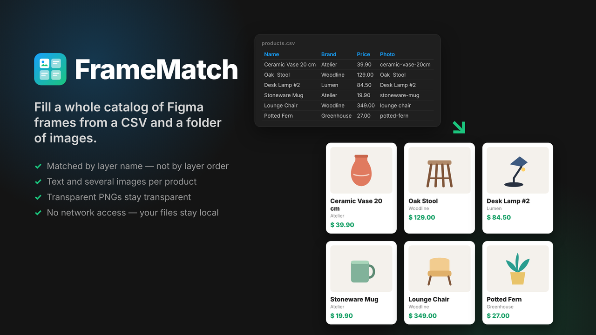
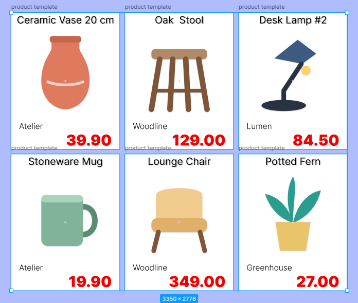
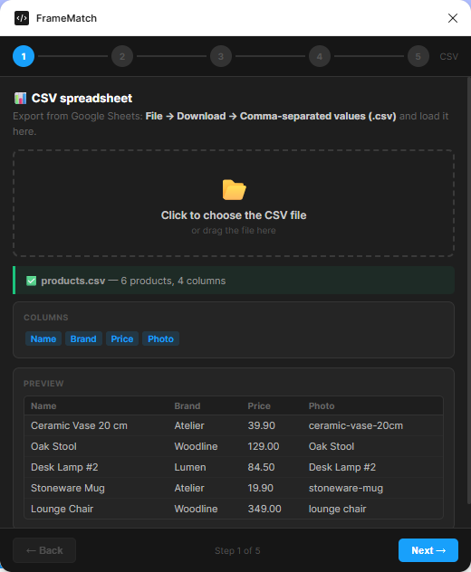
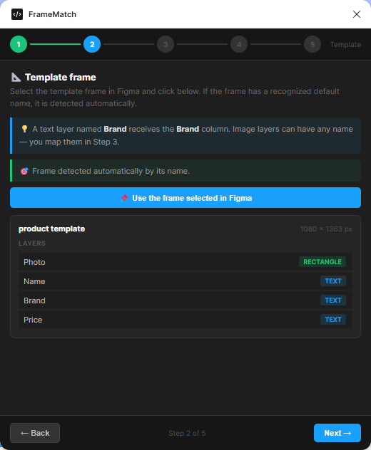
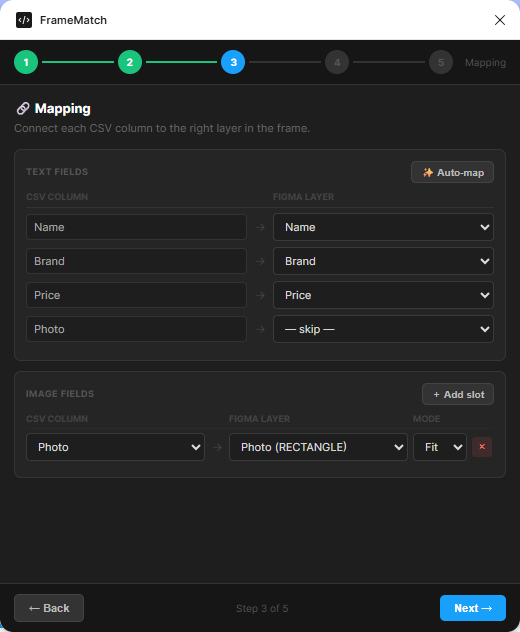
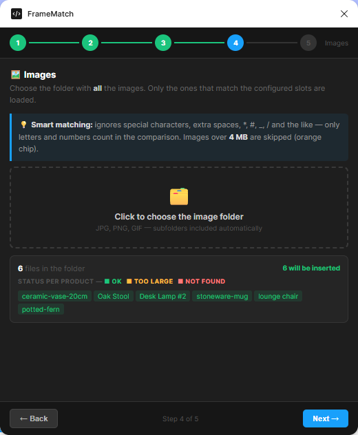
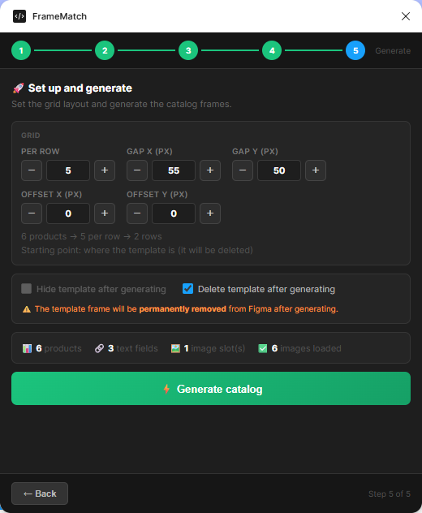
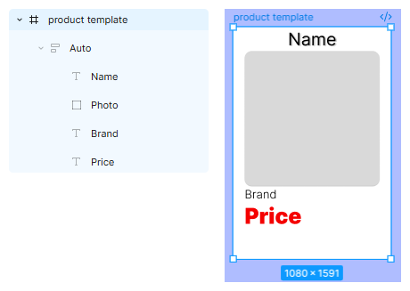
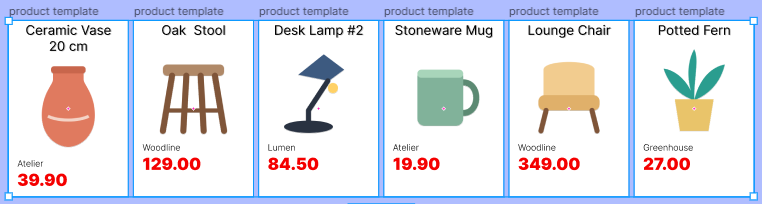

# FrameMatch

**Fill a whole catalog of Figma frames from a CSV and a folder of images — matched by layer name, not by layer order.**

FrameMatch clones a template frame once per row of your spreadsheet and fills each copy: text columns go into the text layers with the same name, and image columns pull the matching file from a folder on your computer. Rename or reorder layers inside the template and it still works, because matching is by **name**.

## How it works — 5 steps

| | |
|---|---|
|  | **1. CSV** — load a `.csv` file. From Google Sheets: *File → Download → Comma-separated values (.csv)*. The first row is the header (column names). |
|  | **2. Template** — select your template frame on the canvas and click *Use the frame selected in Figma*. Frames named `template`, `product`, `products` or `product template` are detected automatically. |
|  | **3. Mapping** — every CSV column is matched to the text layer with the same name (*Auto-map*). Add image slots to connect an image column to an image layer (any layer with a fill), with *Fit* or *Fill*. One product can have several image slots. |
|  | **4. Images** — choose the folder with all your images (subfolders included). FrameMatch shows, product by product, which images were found. |
|  | **5. Generate** — set the grid (per row, gaps, offset) and click *Generate catalog*. |

## CSV format

| Name | Brand | Price | Photo |
|---|---|---|---|
| Ceramic Vase 20 cm | Atelier | 39.90 | ceramic-vase-20cm |
| Oak Stool | Woodline | 129.00 | oak stool |

- Text layers named `Name`, `Brand`, `Price` receive those columns (matching ignores upper/lower case).
- The `Photo` column holds the image **file name**, with or without the extension.

## Images

- Formats: **PNG, JPG, GIF** (Figma does not accept WebP). Transparency in PNG is preserved — images are sent as raw bytes, never re-compressed.
- **Smart matching:** special characters, extra spaces, `*`, `#`, `_`, `/` and the like are ignored; only letters and numbers count. `Oak Stool` matches `oak_stool.png`.
- Images over **4 MB** are skipped (orange chip) — add those by hand in Figma.

## Grid, offset and starting point

- **Per row**, **Gap X**, **Gap Y** set the grid.
- **Starting point:** if *Delete template after generating* is on, the catalog starts **where the template was**; otherwise it starts **to the right of the template** (+60 px).
- **Offset X / Y** shift the whole grid from that starting point (negative values allowed).

## Tip: build the template with Auto Layout

Put the template's content inside an **Auto Layout** frame. When a product name is longer than the others, it wraps and pushes the photo and the price down instead of overlapping them.

## Privacy

FrameMatch has **no network access**. It only reads the CSV and image files you choose, inside Figma, and only changes the file you are working on (it creates the frames, and hides or deletes the template only if you tick those options). Nothing is sent anywhere.

## Support

- Email: joao.l.nunes.da.s@gmail.com
- Bugs and ideas: [GitHub Issues](https://github.com/joaolucas-nds/framematch/issues)

---

*Development notes (Portuguese) live in `meta/`; the plugin itself is `code.js`, `ui.html` and `manifest.json`.*
